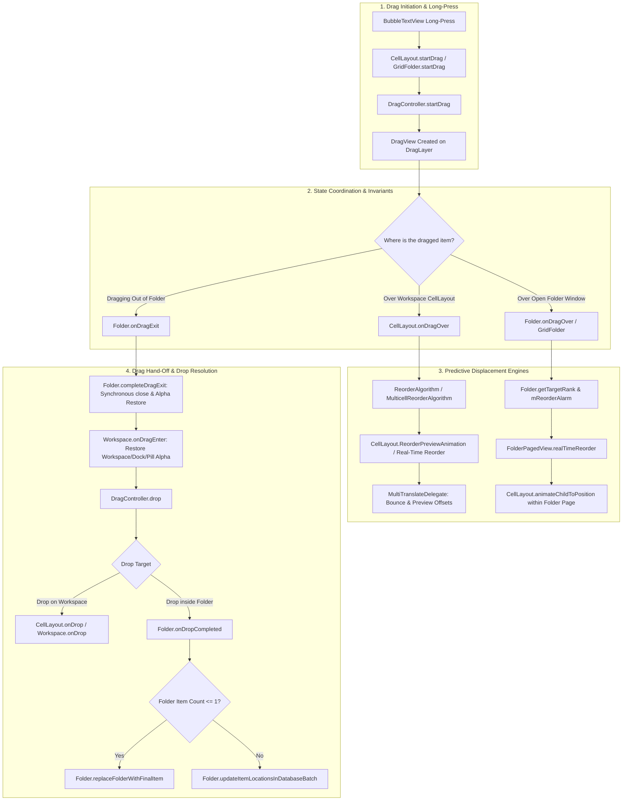

# Homescreen Cell, Predictive Reordering, Folder Drag-and-Drop & State Architecture

This document provides a comprehensive, end-to-end technical reference and complete code implementation of the core UI, gesture, layout, and animation engines in the launcher codebase. It is specifically structured for deep architectural analysis, bug finding, and race-condition auditing.

---

## 1. System Architecture & State Machine

The following diagram illustrates how drag events propagate between the primary state coordinators (`DragController`), the desktop canvas (`Workspace` / `CellLayout`), and the folder overlay (`Folder` / `GridFolder` / `FolderPagedView`):



---

## 2. Hard Invariants & Concurrency Rules

Any review or refactor of these subsystems must respect the following zero-regression rules:

### A. Folder Open State Invariant (`Folder.getOpen(mLauncher) != null`)
While any folder is open (whether idle, in jiggle wobble mode, or during internal dragging/reordering):
* **Workspace Page Items (`CellLayout.getShortcutsAndWidgets()`)**: Must strictly have `alpha = 0f`.
* **Dock Icons (`Hotseat`)**: Must strictly have `alpha = 0f`.
* **Dock Glass Backdrop (`dock_glass`)**: Must strictly have `alpha = 0f`.
* **Page Indicator / Search Pill (`mWorkspace.getPageIndicator()`)**: Must strictly have `alpha = 0f`.
* **Blur Backdrop Layer (`mLauncher.mBlurLayer`)**: Must strictly remain `alpha = 1f`.
* **Anti-Pattern Warning**: Never use global flags like `DragController.isDragging()` to bypass folder open alpha suppression. `isDragging()` is also `true` during internal folder reordering. Bypassing this leaks the dock and search pill behind the folder card.

### B. Drag Exit Hand-off Invariant (`Folder.onDragExit()`)
When an icon is dragged **out** of an open folder onto the workspace canvas:
* In SingleLayerMode (iOS mode), `mOnExitAlarm` is bypassed; `completeDragExit()` executes immediately.
* `Folder.close(true)` synchronously sets `mIsOpen = false` so that `Folder.getOpen(mLauncher)` becomes `null`.
* Workspace items, dock icons, dock glass, and the search pill must be restored to `alpha = 1f` immediately **mid-drag** before the user releases their finger.
* `mBlurLayer` returns to `alpha = 0f`.

### C. Ghost / Orphan Icon Prevention (`ShortcutAndWidgetContainer`)
* Every view removal (`removeView`, `removeViewInLayout`, `removeViewAt`, `removeAllViews`, `removeAllViewsInLayout`) in `ShortcutAndWidgetContainer` **must** invoke `view.clearAnimation()` before removal.
* Android's `ViewGroup` retains views with active non-terminating animations in `mDisappearingChildren` and continues drawing them indefinitely.

---

## 3. Homescreen Cell: Complete Implementation & Measurement

### 3.1. `ShortcutAndWidgetContainer.java`
Controls the physical pixel layout of all cells within a `CellLayout` page.

```java
package com.android.launcher3;

import static com.android.launcher3.CellLayout.FOLDER;
import static com.android.launcher3.CellLayout.HOTSEAT;
import static com.android.launcher3.CellLayout.WORKSPACE;

import android.content.Context;
import android.graphics.PointF;
import android.view.View;
import android.view.ViewGroup;

import androidx.annotation.Nullable;

import com.android.launcher3.celllayout.CellLayoutLayoutParams;
import com.android.launcher3.folder.FolderIcon;
import com.android.launcher3.model.data.ItemInfo;
import com.android.launcher3.widget.NavigableAppWidgetHostView;

import foundation.e.bliss.folder.GridFolder;

public class ShortcutAndWidgetContainer extends ViewGroup {

    private int mCellWidth;
    private int mCellHeight;
    private int mCountX;
    private int mCountY;
    private Integer mBorderSpace;
    private final int mContainerType;
    private boolean mInvertIfRtl = false;
    private final ActivityContext mActivity;
    private @Nullable TranslationProvider mTranslationProvider;

    public ShortcutAndWidgetContainer(Context context, int containerType) {
        super(context);
        mActivity = ActivityContext.lookupContext(context);
        mContainerType = containerType;
    }

    public void setCellDimensions(int cellWidth, int cellHeight, int countX, int countY,
            @Nullable Integer borderSpace) {
        mCellWidth = cellWidth;
        mCellHeight = cellHeight;
        mCountX = countX;
        mCountY = countY;
        mBorderSpace = borderSpace;
    }

    public View getChildAt(int cellX, int cellY) {
        final int count = getChildCount();
        for (int i = 0; i < count; i++) {
            View child = getChildAt(i);
            CellLayoutLayoutParams lp = (CellLayoutLayoutParams) child.getLayoutParams();
            if ((lp.getCellX() <= cellX) && (cellX < lp.getCellX() + lp.cellHSpan)
                    && (lp.getCellY() <= cellY) && (cellY < lp.getCellY() + lp.cellVSpan)) {
                return child;
            }
        }
        return null;
    }

    @Override
    protected void onMeasure(int widthMeasureSpec, int heightMeasureSpec) {
        int count = getChildCount();
        int widthSpecSize = MeasureSpec.getSize(widthMeasureSpec);
        int heightSpecSize = MeasureSpec.getSize(heightMeasureSpec);
        setMeasuredDimension(widthSpecSize, heightSpecSize);

        for (int i = 0; i < count; i++) {
            View child = getChildAt(i);
            if (child.getVisibility() != GONE) {
                measureChild(child);
            }
        }
    }

    public void setupLp(View child) {
        CellLayoutLayoutParams lp = (CellLayoutLayoutParams) child.getLayoutParams();
        if (child instanceof NavigableAppWidgetHostView) {
            DeviceProfile profile = mActivity.getDeviceProfile();
            final PointF appWidgetScale = profile.getAppWidgetScale((ItemInfo) child.getTag());
            lp.setup(mCellWidth, mCellHeight, invertLayoutHorizontally(), mCountX, mCountY,
                    appWidgetScale.x, appWidgetScale.y, mBorderSpace, profile.widgetPadding);
        } else {
            lp.setup(mCellWidth, mCellHeight, invertLayoutHorizontally(), mCountX, mCountY,
                    mBorderSpace);
        }
    }

    public int getCellContentHeight() {
        return Math.min(getMeasuredHeight(),
                mActivity.getDeviceProfile().getCellContentHeight(mContainerType));
    }

    public void measureChild(View child) {
        CellLayoutLayoutParams lp = (CellLayoutLayoutParams) child.getLayoutParams();
        if (!lp.isFullscreen) {
            final DeviceProfile dp = mActivity.getDeviceProfile();

            if (child instanceof NavigableAppWidgetHostView) {
                final PointF appWidgetScale = dp.getAppWidgetScale((ItemInfo) child.getTag());
                lp.setup(mCellWidth, mCellHeight, invertLayoutHorizontally(), mCountX, mCountY,
                        appWidgetScale.x, appWidgetScale.y, mBorderSpace, dp.widgetPadding);
            } else {
                lp.setup(mCellWidth, mCellHeight, invertLayoutHorizontally(), mCountX, mCountY,
                        mBorderSpace);
                int cHeight = getCellContentHeight();
                int cellPaddingY = dp.cellYPaddingPx >= 0 && mContainerType == WORKSPACE
                                ? dp.cellYPaddingPx
                                : (int) Math.max(0, ((lp.height - cHeight) / 2f));

                boolean noPaddingX = (dp.cellLayoutBorderSpacePx.x > 0 && mContainerType == WORKSPACE)
                                || (dp.folderCellLayoutBorderSpacePx.x > 0 && mContainerType == FOLDER)
                                || (dp.hotseatBorderSpace > 0 && mContainerType == HOTSEAT);
                int cellPaddingX = noPaddingX ? 0 : dp.cellLayoutPaddingPx.left;

                child.setPaddingRelative(cellPaddingX, cellPaddingY, cellPaddingX, 0);
            }
            int childWidthMeasureSpec = MeasureSpec.makeMeasureSpec(lp.width, MeasureSpec.EXACTLY);
            int childHeightMeasureSpec = MeasureSpec.makeMeasureSpec(lp.height, MeasureSpec.EXACTLY);
            child.measure(childWidthMeasureSpec, childHeightMeasureSpec);
        }
    }

    public boolean invertLayoutHorizontally() {
        return mInvertIfRtl && Utilities.isRtl(getResources());
    }

    @Override
    protected void onLayout(boolean changed, int l, int t, int r, int b) {
        int count = getChildCount();
        for (int i = 0; i < count; i++) {
            final View child = getChildAt(i);
            if (child.getVisibility() != GONE) {
                CellLayoutLayoutParams lp = (CellLayoutLayoutParams) child.getLayoutParams();
                if (mTranslationProvider != null) {
                    child.setTranslationX(mTranslationProvider.getTranslationX(child));
                }
                int childLeft = lp.x;
                int childTop = lp.y;
                child.layout(childLeft, childTop, childLeft + lp.width, childTop + lp.height);
            }
        }
    }

    // --- ZERO-REGRESSION INVARIANT: GHOST ICON ELIMINATION ---
    @Override
    public void removeView(View view) {
        if (view != null) view.clearAnimation();
        super.removeView(view);
    }

    @Override
    public void removeViewInLayout(View view) {
        if (view != null) view.clearAnimation();
        super.removeViewInLayout(view);
    }

    @Override
    public void removeViewAt(int index) {
        View view = getChildAt(index);
        if (view != null) view.clearAnimation();
        super.removeViewAt(index);
    }

    @Override
    public void removeAllViews() {
        for (int i = 0; i < getChildCount(); i++) getChildAt(i).clearAnimation();
        super.removeAllViews();
    }

    @Override
    public void removeAllViewsInLayout() {
        for (int i = 0; i < getChildCount(); i++) getChildAt(i).clearAnimation();
        super.removeAllViewsInLayout();
    }
}
```

---

## 4. App Predictive Moving Animation (`ReorderPreviewAnimation`)

When an app is dragged across the grid, nearby icons predictively displace to show the user where their item will land and where displaced icons will shift.

### 4.1. `ReorderPreviewAnimation.kt`
Calculates vector angles, displacements, and oscillation animators using `MultiTranslateDelegate`.

```kotlin
package com.android.launcher3.celllayout

import android.animation.ObjectAnimator
import android.animation.ValueAnimator
import android.animation.ValueAnimator.areAnimatorsEnabled
import android.util.ArrayMap
import android.view.View
import com.android.app.animation.Interpolators.DECELERATE_1_5
import com.android.launcher3.CellLayout
import com.android.launcher3.CellLayout.REORDER_ANIMATION_DURATION
import com.android.launcher3.Reorderable
import com.android.launcher3.Workspace
import com.android.launcher3.util.MultiTranslateDelegate.INDEX_REORDER_BOUNCE_OFFSET
import com.android.launcher3.util.Thunk
import foundation.e.bliss.multimode.MultiModeController
import kotlin.math.abs
import kotlin.math.atan
import kotlin.math.cos
import kotlin.math.sign
import kotlin.math.sin

class ReorderPreviewAnimation<T>(
    val child: T,
    val mode: Int,
    cellX0: Int,
    cellY0: Int,
    cellX1: Int,
    cellY1: Int,
    spanX: Int,
    spanY: Int,
    reorderMagnitude: Float,
    cellLayout: CellLayout,
    private val shakeAnimators: ArrayMap<Reorderable, ReorderPreviewAnimation<T>>
) : ValueAnimator.AnimatorUpdateListener where T : View, T : Reorderable {

    private var finalDeltaX = 0f
    private var finalDeltaY = 0f
    private var initDeltaX = child.getTranslateDelegate().getTranslationX(INDEX_REORDER_BOUNCE_OFFSET).value
    private var initDeltaY = child.getTranslateDelegate().getTranslationY(INDEX_REORDER_BOUNCE_OFFSET).value
    private var initScale = child.getReorderBounceScale()
    private val finalScale = CellLayout.DEFAULT_SCALE - CHILD_DIVIDEND / child.width * initScale

    private val dir = if (mode == MODE_HINT) -1 else 1
    var animator: ValueAnimator =
        ObjectAnimator.ofFloat(0f, 1f).also {
            it.addUpdateListener(this)
            it.duration = (if (mode == MODE_HINT) HINT_DURATION else PREVIEW_DURATION).toLong()
            it.startDelay = (Math.random() * 60).toLong()
            if (areAnimatorsEnabled() && mode == MODE_PREVIEW) {
                it.repeatCount = ValueAnimator.INFINITE
                it.repeatMode = ValueAnimator.REVERSE
            }
        }

    init {
        val tmpRes = intArrayOf(0, 0)
        cellLayout.regionToCenterPoint(cellX0, cellY0, spanX, spanY, tmpRes)
        val (x0, y0) = tmpRes
        cellLayout.regionToCenterPoint(cellX1, cellY1, spanX, spanY, tmpRes)
        val (x1, y1) = tmpRes
        val dX = x1 - x0
        val dY = y1 - y0

        if (dX != 0 || dY != 0) {
            if (dY == 0) {
                finalDeltaX = -dir * sign(dX.toFloat()) * reorderMagnitude
            } else if (dX == 0) {
                finalDeltaY = -dir * sign(dY.toFloat()) * reorderMagnitude
            } else {
                val angle = atan((dY.toFloat() / dX))
                finalDeltaX = (-dir * sign(dX.toFloat()) * abs(cos(angle) * reorderMagnitude))
                finalDeltaY = (-dir * sign(dY.toFloat()) * abs(sin(angle) * reorderMagnitude))
            }
        }
    }

    fun animate() {
        // SingleLayerMode (iOS Mode) uses deterministic real-time grid flow instead of oscillating vibration
        if (MultiModeController.isSingleLayerMode) return
        val noMovement = finalDeltaX == 0f && finalDeltaY == 0f
        if (shakeAnimators.containsKey(child)) {
            val oldAnimation: ReorderPreviewAnimation<T>? = shakeAnimators.remove(child)
            if (noMovement) {
                oldAnimation!!.finishAnimation()
                return
            } else {
                oldAnimation!!.cancel()
            }
        }
        if (noMovement) return
        shakeAnimators[child] = this
        animator.start()
    }

    override fun onAnimationUpdate(updatedAnimation: ValueAnimator) {
        val progress = updatedAnimation.animatedValue as Float
        child.getTranslateDelegate().setTranslation(
            INDEX_REORDER_BOUNCE_OFFSET,
            progress * finalDeltaX + (1 - progress) * initDeltaX,
            progress * finalDeltaY + (1 - progress) * initDeltaY
        )
        child.setReorderBounceScale(progress * finalScale + (1 - progress) * initScale)
    }

    @Thunk
    fun finishAnimation() {
        animator.cancel()
        initScale = CellLayout.DEFAULT_SCALE
        initDeltaX = 0f
        initDeltaY = 0f
        animator = ObjectAnimator.ofFloat((animator.animatedValue as Float), 0f)
        animator.addUpdateListener(this)
        animator.interpolator = DECELERATE_1_5
        animator.duration = REORDER_ANIMATION_DURATION.toLong()
        animator.start()
    }

    companion object {
        const val PREVIEW_DURATION = 300
        const val HINT_DURATION = Workspace.REORDER_TIMEOUT
        private const val CHILD_DIVIDEND = 4.0f
        const val MODE_HINT = 0
        const val MODE_PREVIEW = 1
    }
}
```

---

## 5. Folder Architecture (`Folder.java` & `GridFolder.java`)

`GridFolder` extends standard `Folder` to provide iOS-style full-screen frosted glass card presentation, wobbling edit mode, and dynamic page measurement.

### 5.1. `GridFolder.java` Lifecycle & Desktop Suppression
```java
package foundation.e.bliss.folder;

import static com.android.launcher3.LauncherState.NORMAL;
import static com.android.launcher3.LauncherState.OVERVIEW;

import android.animation.Animator;
import android.animation.AnimatorListenerAdapter;
import android.animation.AnimatorSet;
import android.content.Context;
import android.graphics.Color;
import android.graphics.drawable.Drawable;
import android.util.AttributeSet;
import android.view.Gravity;
import android.view.LayoutInflater;
import android.view.View;
import android.widget.FrameLayout;

import com.android.launcher3.CellLayout;
import com.android.launcher3.DeviceProfile;
import com.android.launcher3.Hotseat;
import com.android.launcher3.Launcher;
import com.android.launcher3.LauncherState;
import com.android.launcher3.R;
import com.android.launcher3.Workspace;
import com.android.launcher3.dragndrop.DragLayer;
import com.android.launcher3.dragndrop.DragOptions;
import com.android.launcher3.folder.Folder;
import com.android.launcher3.model.data.WorkspaceItemInfo;

public class GridFolder extends Folder {
    private final Launcher mLauncher;
    public View mFolderTab;
    public View mGlassView;
    public FrameLayout mGridFolderPage;
    private boolean isFolderWobbling = false;

    public GridFolder(Context context, AttributeSet attrs) {
        super(context, attrs);
        mLauncher = mLauncherDelegate.getLauncher();
    }

    @Override
    public void onFolderOpenStart() {
        if (!mLauncher.isInState(NORMAL)) {
            mLauncher.getStateManager().goToState(LauncherState.NORMAL, false);
        }
        updateFolderNamePadding();
        showOrHideDesktop(mLauncher, true);
        if (mLauncher.getWorkspace().isWobbling()) {
            wobbleFolder(true);
        }
    }

    @Override
    protected void onFolderCloseComplete() {
        showOrHideDesktop(mLauncher, false);
        Workspace<?> ws = mLauncher.getWorkspace();
        boolean onAppLibOrPinned = ws != null && (ws.isAppLibraryCurrentPage()
                || (ws.getFirstPagePinnedItem() != null && ws.getNextPage() == 0));
        if (!onAppLibOrPinned && Folder.getOpen(mLauncher) == null) {
            if (mLauncher.mBlurLayer != null) {
                mLauncher.mBlurLayer.setAlpha(0f);
            }
            View dockGlass = mLauncher.findViewById(R.id.dock_glass);
            if (dockGlass != null) {
                dockGlass.setVisibility(VISIBLE);
                dockGlass.setAlpha(1f);
            }
        }
    }

    private void showOrHideDesktop(Launcher launcher, boolean hide) {
        Workspace<?> workspace = launcher.getWorkspace();
        Hotseat hotseat = launcher.getHotseat();
        boolean isSingleLayer = foundation.e.bliss.multimode.MultiModeController.isSingleLayerMode();

        if (!hide) {
            // Restore desktop visibility upon close
            if (workspace != null) {
                workspace.setVisibility(VISIBLE);
                workspace.setAlpha(1f);
                for (int i = 0; i < workspace.getPageCount(); i++) {
                    View page = workspace.getChildAt(i);
                    if (page instanceof CellLayout) {
                        CellLayout cl = (CellLayout) page;
                        cl.setVisibility(VISIBLE);
                        cl.setAlpha(1f);
                        if (cl.getShortcutsAndWidgets() != null) {
                            cl.getShortcutsAndWidgets().setVisibility(VISIBLE);
                            cl.getShortcutsAndWidgets().setAlpha(1f);
                        }
                    }
                }
            }
            if (hotseat != null) {
                hotseat.setAlpha(1f);
                hotseat.setIconsAlpha(1f);
                hotseat.setVisibility(VISIBLE);
            }
            View dockGlass = launcher.findViewById(R.id.dock_glass);
            if (dockGlass != null) {
                dockGlass.setVisibility(VISIBLE);
                dockGlass.setAlpha(1f);
            }
            return;
        }

        // Hide desktop items behind open folder card
        if (hotseat != null) {
            hotseat.setIconsAlpha(0f);
        }
        View dockGlass = launcher.findViewById(R.id.dock_glass);
        if (dockGlass != null) {
            dockGlass.setAlpha(0f);
        }
        if (workspace != null && workspace.getPageIndicator() != null) {
            workspace.getPageIndicator().setAlpha(0f);
        }
    }

    @Override
    public boolean startDrag(View v, DragOptions options) {
        if (!isFolderWobbling && mLauncher.getWorkspace() != null
                && mLauncher.getWorkspace().isWobbling()) {
            wobbleFolder(true);
        }
        if (v.getTag() instanceof WorkspaceItemInfo) {
            v.clearAnimation();
        }
        return super.startDrag(v, options);
    }
}
```

---

## 6. Inside-Folder App Rearranging Logic & Animation

When dragging an app **inside** an open folder:
1. `Folder.onDragOver` maps visual touch coordinates to target rank cells via `getTargetRank()`.
2. When the rank changes, `mReorderAlarm` starts a debounce timer (`REORDER_DELAY = 150ms`).
3. On alarm trigger, `FolderPagedView.realTimeReorder(mEmptyCellRank, mTargetRank)` animates sibling icons to make room.

### 6.1. `FolderPagedView.java` (`realTimeReorder`)
```java
    /**
     * Reorders the items such that the {@param empty} spot moves to {@param target}
     */
    public void realTimeReorder(int empty, int target) {
        if (!mViewsBound) return;
        completePendingPageChanges();
        int delay = 0;
        float delayAmount = START_VIEW_REORDER_DELAY;

        int pageToAnimate = getNextPage();
        int maxItemsPerPage = mOrganizer.getMaxItemsPerPage();

        int pageT = target / maxItemsPerPage;
        int pagePosT = target % maxItemsPerPage;

        if (pageT != pageToAnimate) {
            Log.e(TAG, "Cannot animate when the target cell is invisible");
        }
        int pagePosE = empty % maxItemsPerPage;
        int pageE = empty / maxItemsPerPage;

        int startPos, endPos;
        int moveStart, moveEnd;
        int direction;

        if (target == empty) {
            return;
        } else if (target > empty) {
            direction = 1;
            if (pageE < pageToAnimate) {
                moveStart = empty;
                moveEnd = pageToAnimate * maxItemsPerPage;
                startPos = 0;
            } else {
                moveStart = moveEnd = -1;
                startPos = pagePosE;
            }
            endPos = pagePosT;
        } else {
            direction = -1;
            if (pageE > pageToAnimate) {
                moveStart = empty;
                moveEnd = (pageToAnimate + 1) * maxItemsPerPage - 1;
                startPos = maxItemsPerPage - 1;
            } else {
                moveStart = moveEnd = -1;
                startPos = pagePosE;
            }
            endPos = pagePosT;
        }

        // Instant moving views across pages
        while (moveStart != moveEnd) {
            int rankToMove = moveStart + direction;
            int p = rankToMove / maxItemsPerPage;
            int pagePos = rankToMove % maxItemsPerPage;
            int x = pagePos % mGridCountX;
            int y = pagePos / mGridCountX;

            final CellLayout page = getPageAt(p);
            final View v = page.getChildAt(x, y);
            if (v != null) {
                v.clearAnimation();
                if (pageToAnimate != p) {
                    page.removeView(v);
                    addViewForRank(v, (WorkspaceItemInfo) v.getTag(), moveStart);
                } else {
                    final int newRank = moveStart;
                    final float oldTranslateX = v.getTranslationX();

                    Runnable endAction = () -> {
                        mPendingAnimations.remove(v);
                        v.setTranslationX(oldTranslateX);
                        ((CellLayout) v.getParent().getParent()).removeView(v);
                        addViewForRank(v, (WorkspaceItemInfo) v.getTag(), newRank);
                    };
                    v.animate()
                        .translationXBy((direction > 0 ^ mIsRtl) ? -v.getWidth() : v.getWidth())
                        .setDuration(REORDER_ANIMATION_DURATION)
                        .setStartDelay(0)
                        .withEndAction(endAction);
                    mPendingAnimations.put(v, endAction);
                }
            }
            moveStart = rankToMove;
        }

        if ((endPos - startPos) * direction <= 0) return;

        // Animated position shift within active folder page
        CellLayout page = getPageAt(pageToAnimate);
        for (int i = startPos; i != endPos; i += direction) {
            int nextPos = i + direction;
            View v = page.getChildAt(nextPos % mGridCountX, nextPos / mGridCountX);
            if (mFolder instanceof GridFolder && ((GridFolder) mFolder).isFolderWobbling() && v != null) {
                v.clearAnimation();
            }
            if (page.animateChildToPosition(v, i % mGridCountX, i / mGridCountX,
                    REORDER_ANIMATION_DURATION, delay, true, true)) {
                delay += delayAmount;
                delayAmount *= VIEW_REORDER_DELAY_FACTOR;
            }
        }

        if (mFolder instanceof GridFolder && ((GridFolder) mFolder).isFolderWobbling()) {
            ((GridFolder) mFolder).wobbleFolder(true);
        }
    }
```

### 6.2. Drag Exit Hand-off from Folder (`completeDragExit`)
```java
    public void completeDragExit() {
        if (mIsOpen) {
            close(true);
            mRearrangeOnClose = true;
        } else if (mState == STATE_ANIMATING) {
            mRearrangeOnClose = true;
        } else {
            rearrangeChildren();
            clearDragInfo();
        }

        if (foundation.e.bliss.multimode.MultiModeController.isSingleLayerMode()) {
            Launcher launcher = mLauncherDelegate.getLauncher();
            if (launcher != null) {
                Workspace<?> workspace = launcher.getWorkspace();
                if (workspace != null) {
                    workspace.setVisibility(VISIBLE);
                    workspace.setAlpha(1f);
                    for (int i = 0; i < workspace.getPageCount(); i++) {
                        View page = workspace.getChildAt(i);
                        if (page instanceof CellLayout) {
                            CellLayout cl = (CellLayout) page;
                            cl.setVisibility(VISIBLE);
                            cl.setAlpha(1f);
                            if (cl.getShortcutsAndWidgets() != null) {
                                cl.getShortcutsAndWidgets().setVisibility(VISIBLE);
                                cl.getShortcutsAndWidgets().setAlpha(1f);
                            }
                        }
                    }
                    if (!workspace.isAppLibraryCurrentPage()) {
                        View pi = workspace.getPageIndicator();
                        if (pi != null) {
                            pi.setVisibility(VISIBLE);
                            pi.setAlpha(1f);
                            if (pi instanceof PageIndicatorDots) {
                                ((PageIndicatorDots) pi).setForcedTranslationY(0f);
                                ((PageIndicatorDots) pi).resetToIdle();
                            }
                            workspace.showPageIndicatorAtCurrentScroll();
                        }
                    }
                }
                if (workspace != null && !workspace.isAppLibraryCurrentPage()) {
                    Hotseat hotseat = launcher.getHotseat();
                    if (hotseat != null) {
                        hotseat.setVisibility(VISIBLE);
                        hotseat.setAlpha(1f);
                        hotseat.setIconsAlpha(1f);
                        hotseat.setForcedTranslationY(0f);
                    }
                    View dockGlass = launcher.findViewById(R.id.dock_glass);
                    if (dockGlass != null) {
                        dockGlass.setVisibility(VISIBLE);
                        dockGlass.setAlpha(1f);
                        dockGlass.setTranslationY(0f);
                    }
                    if (launcher.mBlurLayer != null) {
                        launcher.mBlurLayer.setAlpha(0f);
                    }
                }
            }
        }
    }
```

---

## 7. State Transitions & Bug Hunter Guide (Audit Focus)

When having another LLM evaluate this code, direct its attention to these high-risk synchronization and state areas:

| Area | High-Risk Bug Mechanism | What to Inspect in Code |
| :--- | :--- | :--- |
| **Folder Exit Hand-off** | Race between `Folder.onDragExit()` -> `completeDragExit()` and `Workspace.onDragEnter()`. If `Folder.mIsOpen` remains `true` for even one frame during hand-off, `WorkspaceStateTransitionAnimation` evaluates `Folder.getOpen(mLauncher) != null` as `true` and suppresses the workspace icons to `0f` mid-drag! | Verify synchronous `close(true)` setting `mIsOpen = false` immediately before `workspace.setAlpha(1f)`. |
| **Wobble vs Displacement Collision** | In jiggle/wobble mode, icons have continuous oscillating rotation animations (`-2°` to `+2°`). When `realTimeReorder` moves an item with `animateChildToPosition()`, the running wobble animation interferes with property setters or leaves items in `mDisappearingChildren`. | Check `v.clearAnimation()` calls prior to reorder and re-triggering `wobbleFolder(true)` after reorder completion. |
| **Folder Collapse Edge-Case** | Dragging an item out of a folder containing exactly 2 items. If dropped on workspace, the folder must collapse into a standard app icon (`replaceFolderWithFinalItem`). | Check `onDropCompleted()`: `getItemCount() <= 1` trigger, handling of `mDeleteFolderOnDropCompleted`, and avoiding deleting folder if item was dragged back inside. |
| **Coordinate Mapping & Padding** | `getTargetRank()` translating `DragObject.getVisualCenter()` from `DragLayer` space to `GridFolder` descendant coordinates. | Check `mapCoordInSelfToDescendant(page, coord)`. An inaccurate offset calculation causes icons to jump to wrong target ranks during rapid drags. |
| **Multi-page Folder Overflow** | Dragging item to right/left edge of folder page to trigger auto-paging (`showScrollHint`). If page is added (`mContent.createAndAddNewPage()`) during an active drag, views can become unparented. | Verify `completePendingPageChanges()` in `realTimeReorder` and `mScrollPauseAlarm`. |
